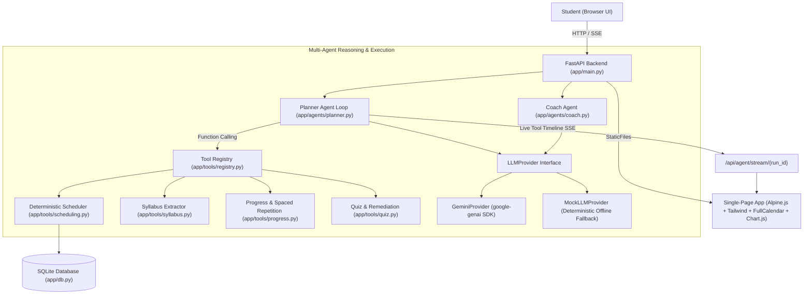

# AdaptivePlan: An Autonomous Study Planner

> **An LLM-Powered Autonomous Multi-Agent Study Planning & Rescheduling System for Engineering Students**  
> Built with Pre-trained Google Gemini LLM, Autonomous ReAct Tool Calling, and Deterministic Constraint Algorithms.

[](https://www.python.org/)
[](https://fastapi.tiangolo.com/)
[](https://ai.google.dev/)
[]()
[]()

---

## 1. Project Overview

Engineering students typically manage 4 to 6 technical subjects simultaneously, with strict exam deadlines, variable syllabus difficulties, and constrained daily study hours. When an unexpected event occurs—such as falling behind on a difficult topic or missing a study session—traditional static timetables collapse, leading to cramming, panic, and burnout.

### Why Standard LLM Chatbots Fail at Scheduling
If you ask ChatGPT or Claude to generate a study plan, they output pleasing markdown tables. However:
- **Date & Math Hallucinations:** Large language models are next-token predictors. They cannot reliably solve constraint satisfaction problems and frequently produce overlapping time slots, schedule study after exam dates, or violate daily capacity caps.
- **No Execution State:** A chat thread has no persistent database to record completed vs. missed tasks.
- **Brittle Re-planning:** If you miss two days of study, you have to manually reprompt from scratch.

### The AdaptivePlan Solution
**AdaptivePlan** is not a chatbot—it is an **Autonomous Multi-Agent System**:
- **Strict Separation of Concerns:** The LLM *never* hallucinates dates or writes directly to the calendar. The LLM acts as an orchestrator that invokes deterministic Python tools (`create_schedule`, `calculate_priority`, `check_conflicts`, `compress_plan`).
- **Autonomous ReAct Loop:** Uses the Reasoning + Acting pattern with native tool calling to construct, audit, and self-correct timetables.
- **Closed-Loop Self-Correction:** The agent audits its own output with `check_conflicts`. If any constraint is violated, it iterates and resolves conflicts until **zero conflicts** remain.
- **Dynamic Re-planning & Panic Mode:** 1-click intelligent recovery that redistributes unfinished tasks while strictly preserving completed records.

---

## 2. System Architecture



---

## 3. Mathematical Foundations

### 1. Deterministic Topic Prioritization
Topics are ranked for allocation according to urgency, difficulty, past-paper weightage, and mastery deficit:

$$\text{Priority} = \frac{1}{\max(1, \text{Days Until Exam})} \times \text{Difficulty} \times \text{Weightage} \times \left(1 + \max(0.0, 1.0 - \text{Mastery})\right)$$

- **Urgency Factor:** Topics with exams in 2 days receive $5\times$ higher priority than those 10 days away.
- **Mastery Deficit:** Unmastered topics ($\text{Mastery} = 0.0$) receive a $2.0\times$ multiplier compared to fully mastered topics ($1.0\times$).

### 2. Constraint Satisfaction & Scheduling Rules
- **Back-to-Back Slot Filling:** Multi-hour slots are packed continuously rather than placing only one task per window.
- **Energy Window Matching:** High-difficulty topics ($\ge 4/5$) are preferentially matched with peak-energy free slots (e.g. morning/evening).
- **Cognitive Interleaving:** Topics from the same subject are interleaved to reduce mental fatigue.
- **48-Hour Pre-Exam Revision Buffer:** In the final 2 days before each exam, normal study tasks are locked, and targeted 1-hour revision tasks are scheduled for each topic in order of weightage.
- **Rest Interval:** Mandatory 15-minute breaks are inserted after every 90 minutes of continuous study.

### 3. Spaced Repetition (Ebbinghaus Forgetting Curve)
When a student answers a quiz question incorrectly, topic mastery drops. The revision interval follows:

$$I_n = I_1 \times (\text{EF})^{n-1}$$

Where $I$ is the interval in days and $\text{EF}$ is the Easiness Factor calculated from quiz performance.

---

## 4. Key Agent Capabilities

| Agent / Feature | Implementation | Description |
| :--- | :--- | :--- |
| **Planner Agent** | `app/agents/planner.py` | Multi-step ReAct agent using Gemini function calling to retrieve free slots, prioritize, schedule, and verify zero conflicts. |
| **Self-Correction Engine** | `app/tools/scheduling.py` | Audits daily hour overloads, time overlaps, and missing pre-exam buffers. Iteratively fixes issues up to 8 iterations. |
| **AI Coach Agent** | `app/agents/coach.py` | Analyzes pace, burnout risks (>5 consecutive heavy days), and cognitive balance to generate actionable coaching advice. |
| **Concept Explainer** | `app/tools/quiz.py` | Context-aware generative explanation of any scheduled topic with academic definitions, formulas, and examples. |
| **Remedial Quiz Generator** | `app/tools/quiz.py` | Generates 3 targeted MCQs per topic with robust letter/text normalization and grading. |
| **Dynamic Replanner** | `replan_internal` | Re-allocates unfinished tasks into remaining days while strictly preserving completed tasks. |
| **Panic Mode** | `compress_plan_internal` | When exam time is critically short, prunes low-yield units and focuses 100% of available hours on high-weightage topics. |
| **Offline-Safe UI** | `static/vendor/` | Bundled vendor assets (Alpine.js 3.14.3, FullCalendar 6.1.15, Chart.js 4.4.6) with zero external CDN dependencies. |

---

## 5. Technology Stack

- **Backend:** Python 3.10+, FastAPI, Uvicorn, SQLite3, Pydantic v2, AnyIO
- **Generative AI & LLM:** Google Gemini 2.5 Flash / 3.1 Flash-Lite (`google-genai` SDK)
- **Fallback Engine:** Custom Algorithmic `MockLLMProvider` ensuring 100% test pass rate and zero-downtime offline demonstrations
- **Frontend:** HTML5, Tailwind CSS, Alpine.js, FullCalendar, Chart.js
- **Testing & Tooling:** Pytest, AnyIO, Pyflakes

---

## 6. Project Structure

```
AdaptivePlan/
├── app/
│   ├── agents/               # Autonomous agent loops
│   │   ├── coach.py          # AI Coach burnout & balance analysis
│   │   └── planner.py        # ReAct Planner Agent with tool calling & self-correction
│   ├── llm/                  # LLM Provider abstraction
│   │   ├── gemini.py         # Google Gemini integration (google-genai SDK)
│   │   ├── mock.py           # Algorithmic deterministic mock provider
│   │   └── provider.py       # Abstract provider interface
│   ├── tools/                # Deterministic tools invoked by agents
│   │   ├── progress.py       # Daily check-in & spaced repetition
│   │   ├── quiz.py           # MCQ generation, grading & explanation
│   │   ├── registry.py       # Tool definitions & Pydantic validation schemas
│   │   ├── scheduling.py     # Deterministic scheduler, conflict auditor & replanner
│   │   └── syllabus.py       # Unstructured syllabus parser
│   ├── config.py             # Environment configuration
│   ├── db.py                 # SQLite schema, connections & seed data
│   ├── main.py               # FastAPI application & REST/SSE endpoints
│   └── models.py             # Pydantic data models & tool argument schemas
├── data/
│   └── demo_seed.json        # Standard demonstration student curriculum
├── static/                   # Offline-bundled Single-Page Application
│   ├── vendor/               # Local Alpine.js, FullCalendar, Chart.js
│   ├── app.js                # Frontend reactive state & SSE stream consumer
│   ├── index.html            # Main user interface
│   └── styles.css            # Custom responsive typography & dark mode styles
├── tests/                    # Comprehensive automated test suite (51 tests)
├── .env.example              # Template configuration
├── .gitignore                # Excludes secrets, databases, and caches
├── pytest.ini                # Pytest configuration
├── README.md                 # Complete system documentation
├── requirements.txt          # Production dependencies
└── run.py                    # Application launch entry point
```

---

## 7. Getting Started

### Prerequisites
- Python 3.10 or higher installed.
- (Optional) A Google Gemini API key from [Google AI Studio](https://aistudio.google.com/).

### Installation

1. **Clone the repository:**
   ```bash
   git clone https://github.com/DipeshNawani/AdaptivePlan-An-Autonomous-Study-Planner.git
   cd AdaptivePlan-An-Autonomous-Study-Planner
   ```

2. **Create and activate a virtual environment (recommended):**
   ```bash
   # Windows
   python -m venv venv
   .\venv\Scripts\activate

   # Linux / macOS
   python3 -m venv venv
   source venv/bin/activate
   ```

3. **Install dependencies:**
   ```bash
   pip install -r requirements.txt
   ```

4. **Configure Environment:**
   Copy `.env.example` to `.env`:
   ```bash
   copy .env.example .env     # Windows
   cp .env.example .env       # Linux / macOS
   ```
   - Add your `GEMINI_API_KEY` to `.env` to enable live Gemini AI.
   - Or leave it blank — AdaptivePlan will seamlessly run in **Deterministic Mock Mode** with 0 external API dependencies.

5. **Start the Application:**
   ```bash
   python run.py
   ```
   Open your browser and navigate to: `http://127.0.0.1:8000`

---

## 8. Automated Testing

AdaptivePlan includes **51 automated tests** verifying every component of the system:
- Deterministic scheduling math, priority calculations, and energy window matching
- Conflict auditor accuracy (overloads, overlaps, pre-exam buffer violations)
- ReAct Agent self-correction loops ending in 0 conflicts
- Safe grading for options sharing prefix letters
- Dynamic replan task preservation and Panic Mode yield pruning
- Offline and live fallback resilience

Run the full test suite:
```bash
pytest tests/ -v
```

All 51 tests pass reliably both with and without `GEMINI_API_KEY` set.

---

## 9. Security & Privacy

- **No Secret Leaks:** `.env` and personal API credentials are never tracked or committed.
- **Local Storage:** All study plans and student progress are stored in a private local SQLite database (`data/adaptiveplan.db`).
- **File Upload Sanitization:** Uploaded syllabus documents are stripped of path traversal attempts, assigned UUIDs, and cleaned up automatically.

---

## 10. License

This project is licensed under the MIT License — see the LICENSE file for details.
