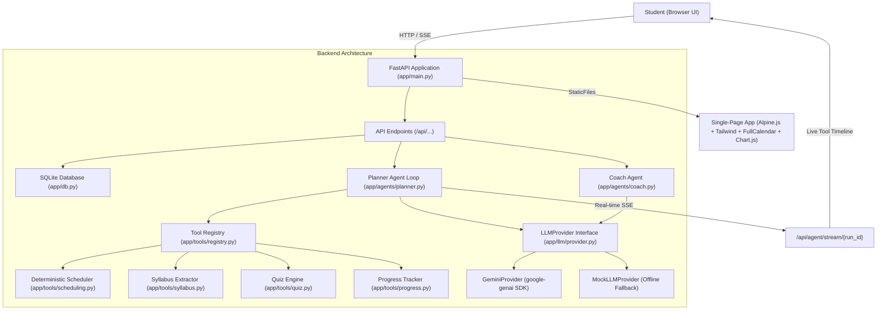

# AdaptivePlan: Implementation Plan & Architecture Blueprint

## Executive Overview
**AdaptivePlan** is an LLM-powered autonomous study planning agent with dynamic rescheduling tailored for engineering students. The system integrates deterministic scheduling algorithms with a tool-calling **Planner Agent** (with self-correction and loop limits) and a specialized **Coach Agent** for plan auditing and student well-being.

---

## 1. System Architecture & Tech Stack



### Key Technical Decisions
- **Backend**: FastAPI + Uvicorn running synchronously and asynchronously. No Node.js, no npm, no build pipelines.
- **Frontend**: Plain HTML5, Tailwind CSS via CDN, Alpine.js 3 via CDN for reactivity, FullCalendar 6 via CDN, Chart.js 4 via CDN.
- **Database**: SQLite3 via lightweight helper wrapper with transactions, foreign keys enabled, and dictionary row factories.
- **LLM Abstraction**: `LLMProvider` abstract base class with implementations:
  1. `GeminiProvider`: uses `google-genai` SDK with strict JSON schemas and native function-calling.
  2. `MockLLMProvider`: zero external calls, canned realistic responses that simulate tool-calling and coaching for offline viva/testing.
- **Operating System Compatibility**: Strict Windows compatibility (`encoding="utf-8"`, `pathlib.Path`, cross-platform signals/subprocess, no raw terminal ANSI emojis).

---

## 2. Database Schema (SQLite)

Tables to be created in `app/db.py`:

```sql
CREATE TABLE IF NOT EXISTS profile (
    id INTEGER PRIMARY KEY CHECK (id = 1),
    max_daily_hours REAL NOT NULL DEFAULT 4.0,
    preferred_time TEXT NOT NULL DEFAULT 'evening', -- 'morning', 'afternoon', 'evening', 'night'
    break_minutes INTEGER NOT NULL DEFAULT 15,
    burnout_threshold_days INTEGER NOT NULL DEFAULT 5,
    created_at TIMESTAMP DEFAULT CURRENT_TIMESTAMP
);

CREATE TABLE IF NOT EXISTS free_slots (
    id INTEGER PRIMARY KEY AUTOINCREMENT,
    weekday INTEGER NOT NULL, -- 0 = Monday, 6 = Sunday
    start_time TEXT NOT NULL, -- 'HH:MM'
    end_time TEXT NOT NULL,   -- 'HH:MM'
    energy TEXT NOT NULL DEFAULT 'high' -- 'high' | 'low'
);

CREATE TABLE IF NOT EXISTS subjects (
    id INTEGER PRIMARY KEY AUTOINCREMENT,
    name TEXT NOT NULL,
    exam_date TEXT NOT NULL, -- 'YYYY-MM-DD'
    priority INTEGER NOT NULL DEFAULT 1,
    color TEXT DEFAULT '#3B82F6'
);

CREATE TABLE IF NOT EXISTS topics (
    id INTEGER PRIMARY KEY AUTOINCREMENT,
    subject_id INTEGER NOT NULL REFERENCES subjects(id) ON DELETE CASCADE,
    unit TEXT NOT NULL,
    name TEXT NOT NULL,
    difficulty INTEGER NOT NULL DEFAULT 3, -- 1 to 5
    est_hours REAL NOT NULL DEFAULT 2.0,
    weightage REAL NOT NULL DEFAULT 1.0,  -- from past papers or syllabus
    mastery REAL NOT NULL DEFAULT 0.0,    -- 0.0 to 1.0
    status TEXT NOT NULL DEFAULT 'pending' -- 'pending', 'in_progress', 'completed'
);

CREATE TABLE IF NOT EXISTS tasks (
    id INTEGER PRIMARY KEY AUTOINCREMENT,
    topic_id INTEGER NOT NULL REFERENCES topics(id) ON DELETE CASCADE,
    type TEXT NOT NULL DEFAULT 'study', -- 'study', 'revision', 'quiz'
    date TEXT NOT NULL, -- 'YYYY-MM-DD'
    start_time TEXT NOT NULL, -- 'HH:MM'
    end_time TEXT NOT NULL,   -- 'HH:MM'
    duration_hours REAL NOT NULL,
    status TEXT NOT NULL DEFAULT 'pending', -- 'pending', 'done', 'missed', 'needs_revision'
    reason TEXT,
    priority_score REAL DEFAULT 0.0,
    created_at TIMESTAMP DEFAULT CURRENT_TIMESTAMP
);

CREATE TABLE IF NOT EXISTS quiz_results (
    id INTEGER PRIMARY KEY AUTOINCREMENT,
    topic_id INTEGER NOT NULL REFERENCES topics(id) ON DELETE CASCADE,
    score REAL NOT NULL, -- 0.0 to 100.0
    total_questions INTEGER NOT NULL,
    correct_answers INTEGER NOT NULL,
    taken_at TIMESTAMP DEFAULT CURRENT_TIMESTAMP
);

CREATE TABLE IF NOT EXISTS agent_logs (
    id INTEGER PRIMARY KEY AUTOINCREMENT,
    run_id TEXT NOT NULL,
    step INTEGER NOT NULL,
    tool_name TEXT NOT NULL,
    args_json TEXT NOT NULL,
    result_json TEXT NOT NULL,
    thought TEXT,
    created_at TIMESTAMP DEFAULT CURRENT_TIMESTAMP
);

CREATE TABLE IF NOT EXISTS reminders (
    id INTEGER PRIMARY KEY AUTOINCREMENT,
    message TEXT NOT NULL,
    remind_at TEXT NOT NULL, -- 'YYYY-MM-DD HH:MM'
    sent INTEGER NOT NULL DEFAULT 0
);
```

---

## 3. Deterministic Scheduling Engine

The scheduling core is 100% deterministic, guaranteeing zero hallucinations in dates, times, and constraints:

### 3.1 Priority Function
$$\text{Priority} = \left(\frac{1}{\max(1, \text{days\_until\_exam})}\right) \times \text{difficulty} \times \text{weightage} \times \left(1 + (1 - \text{mastery})\right)$$

### 3.2 Allocation Rules
1. **Capacity Guarantee**: Daily allocated hours $\le \text{max\_daily\_hours}$.
2. **Energy Matching**: High difficulty topics ($\ge 4$) are assigned to `high` energy time slots (e.g., mornings or evenings as configured). Low difficulty topics or revision sessions occupy `low` energy windows.
3. **Pomodoro/Pacing Break**: 15-minute break inserted automatically after every 90 minutes of continuous study.
4. **Final Revision Buffer**: The final 2 days prior to any subject's exam date are reserved exclusively for final revision tasks. No new first-time topics are scheduled in this 48-hour buffer.
5. **Subject Interleaving**: Prevents mental fatigue when exams are close by interleaving distinct subjects rather than scheduling 8 consecutive hours of a single subject.
6. **Conflict Resolution (`check_conflicts`)**:
   - Detects any day exceeding `max_daily_hours`.
   - Identifies overlapping time intervals.
   - Flags topics scheduled past or within 2 days of their exam date.
   - Detects subjects lacking a designated final revision.
7. **Replanning (`replan`)**:
   - Preserves all tasks marked `done`.
   - Gathers all `missed` tasks and future `pending` tasks.
   - Re-runs deterministic allocation from the replan anchor date across remaining free slots.
   - Generates a clear delta log ("What changed and why").

---

## 4. Multi-Agent Design & Tool Registry

### 4.1 Planner Agent Loop
1. **Trigger**: Prompt with current student state, available subjects, and goal.
2. **Execution**:
   - Loop counter up to 8 iterations.
   - Planner issues tool call (e.g. `get_free_slots`).
   - Runner executes tool in Python, records output into `agent_logs`, pushes SSE event to UI.
   - Planner reads output, calls subsequent tools (e.g. `create_schedule`).
   - Planner calls `check_conflicts`.
   - If conflicts exist, Planner performs self-correction by adjusting constraints and re-allocating.
   - Planner returns human-readable summary once `check_conflicts` passes.

### 4.2 Coach Agent
- Triggers after schedule generation or replanning.
- Evaluates:
  - Daily hour distributions.
  - Spaced repetition intervals.
  - Burnout risk (>5 days at max capacity).
  - Subject coverage and revision balance.
- Outputs structured JSON:
  ```json
  {
    "score": 88,
    "issues": ["Wednesday Nov 18 exceeds 3.5 hours", "Microprocessors Unit 3 has only 1 revision"],
    "suggestions": ["Shift 1 hour from Wednesday to Friday's open slot"],
    "encouragement": "Great momentum! You're 3 days ahead of the Discrete Math target."
  }
  ```

---

## 5. UI/UX Design & Live SSE Agent Stream

Single-page application (`static/index.html`, `static/app.js`, `static/styles.css`):
1. **Navigation Tabs**:
   - **Dashboard**: Quick metrics, subject progress bars, Exam Readiness Gauges (0-100), Coach review card, Burnout warnings.
   - **Today**: Daily checklist with instant status toggles (Done / Missed / Needs Revision), today's energy timeline, check-in motivational message.
   - **Plan**: FullCalendar with month/week/day views, color-coded subjects, task click modal (Explain plan, Quiz, Reschedule).
   - **Agent Activity**: Live SSE terminal showing Agent thoughts, tool calls with syntax-highlighted collapsible JSON inputs/outputs, self-correction logs.
   - **Syllabus & Setup**: Wizard for subjects, exam dates, study hours, past-paper weightage input, PDF/text syllabus parser.
   - **Quiz & Mastery**: Interactive MCQ test screen with explanations, immediate mastery update, and automatic weak-topic revision scheduling.
2. **Panic Mode Bar**: Fast 1-click compression for upcoming exams with detailed list of pruned vs prioritized high-yield topics.
3. **Export Controls**: Direct download buttons for `.ics` (Apple/Google/Outlook calendar) and printable PDF schedule via ReportLab.
4. **Theme Switcher**: Instant light/dark mode switch with persistent `localStorage` preference.

---

## 6. Implementation Phases (Section 14)

### Phase 1: Skeleton & Environment
- File structure setup.
- `requirements.txt` with exact pinned dependencies (`fastapi`, `uvicorn`, `pydantic`, `python-dotenv`, `pypdf`, `reportlab`, `ics`, `google-genai`, `pytest`, `httpx`).
- `app/config.py` with environment loading and fallback settings.
- `app/db.py` SQLite schema migrations and connection helper.
- `app/models.py` Pydantic schemas for all payloads and tool arguments.
- `data/demo_seed.json` with 4 engineering subjects (e.g. Cloud Computing, AI/ML, Information Security, Software Engineering) and syllabus units.
- `run.py` launcher with automatic port check, UTF-8 environment, and seed verification.
- Basic frontend shell served via FastAPI `StaticFiles`.

### Phase 2: Scheduling Core & Unit Tests
- `app/tools/scheduling.py`:
  - `calculate_priority`
  - `get_free_slots_internal`
  - `create_schedule_internal`
  - `check_conflicts_internal`
  - `replan_internal`
  - `compress_plan_internal` (Panic Mode)
- `tests/test_scheduling.py` & `tests/test_replan.py`:
  - Test max hours enforcement.
  - Test exam buffer preservation.
  - Test energy window mapping.
  - Test conflict detection on forced overlaps.
  - Test replanning without mutating completed tasks.

### Phase 3: LLM Providers, Tools & Planner Loop
- `app/llm/provider.py`: `LLMProvider` interface.
- `app/llm/gemini.py`: Gemini API implementation using `google-genai` SDK with function calling.
- `app/llm/mock.py`: Robust deterministic mock provider for zero-API-key mode.
- `app/tools/registry.py`: Declarative tool definitions with JSON Schema.
- Implementation of remaining tools:
  - `app/tools/syllabus.py` (PDF & text parser)
  - `app/tools/progress.py` (status handler + spaced repetition trigger)
  - `app/tools/quiz.py` (MCQ generation & mastery scoring)
  - `app/tools/reminders.py`
- `app/agents/planner.py`: Autonomous tool loop with max 8 iterations, error catching, self-correction, and DB logging.
- `app/agents/prompts.py`: System prompts for Planner and Coach.
- SSE broadcast queue in `app/main.py` for `/api/agent/stream/{run_id}`.
- `tests/test_tools.py` unit tests for tools.

### Phase 4: Frontend Development
- `static/index.html`: Responsive layout with Tailwind CSS CDN, Alpine.js tabs, FullCalendar, Chart.js.
- `static/app.js`: Alpine.js state store, EventSource listener for live SSE tool logs, FullCalendar renderers, Chart.js readiness gauges.
- `static/styles.css`: Custom scrollbars, calendar badge styling, dark mode classes.
- Verification that demo seed loads and FullCalendar displays day/week slots cleanly.

### Phase 5: Advanced Features & Extras
- **Exam Readiness Engine** (`app/services/readiness.py`): Weighted formula:
  $$\text{Readiness} = 0.4 \times \text{Completion} + 0.3 \times \text{Mastery/Quiz} + 0.2 \times \text{Revision Ratio} + 0.1 \times \text{Urgency Factor}$$
- **Spaced Repetition Scheduler** (`+1`, `+3`, `+7` day automatic revision slots).
- **Coach Agent** (`app/agents/coach.py`): Review endpoint `/api/coach`.
- **Explain This Plan** (`/api/tasks/{id}/explain`): Mathematical breakdown of priority factors and slot assignment rationale.
- **Export Engine** (`app/services/export.py`):
  - `.ics` calendar generation using `ics`.
  - PDF generation using `reportlab` with neat student timetable and subject summaries.
- **Burnout Guard**: Detection of $>5$ consecutive peak study days with proactive warning pills.

### Phase 6: Polish, Documentation & Viva Preparation
- Dark mode toggle with smooth CSS transitions.
- Interactive demo loader button in UI ("Load Demo Student").
- `README.md` with complete setup instructions, architecture Mermaid diagram, tool list, and screenshots guide.
- `VIVA_NOTES.md` comprehensive viva cheat sheet covering:
  - Agent vs Chatbot distinction.
  - Why scheduling math is deterministic while reasoning is agentic.
  - Spaced repetition and cognitive load theory.
  - Self-correction mechanism.
  - Limitations and future work.
- End-to-end testing with `pytest`.

---

## 7. Verification & Acceptance Criteria
- `python run.py` launches cleanly on Windows.
- Seed data loads and plan generates under 30 seconds.
- SSE stream shows at least 4 distinct tool calls during planning.
- Marking tasks as `missed` triggers dynamic replanning with visible diffs.
- All unit and integration tests in `tests/` pass without warnings.
